<picture>
  <source media="(prefers-color-scheme: dark)" srcset="./assets/header-dark.svg" />
  <source media="(prefers-color-scheme: light)" srcset="./assets/header-light.svg" />
  
</picture>

  
  
  
  
  

 

## About

- 결제 · 예약처럼 정확해야 하는 기능을 **설계부터 운영까지** 맡아 왔습니다.
- 문제가 생기면 짐작으로 고치지 않고, **실행 계획 · 로그 · 데이터로 원인부터 확인**합니다.
- 고친 뒤에는 원인과 해결 과정을 **회고로 남겨**, 팀이 같은 실수를 반복하지 않게 합니다.
- 반복되는 절차는 **Claude Code 커스텀 스킬**로 만들어 팀이 함께 쓰도록 정리합니다.

 

## Troubleshooting

실제 운영 중에 겪은 문제를 어떻게 확인하고 해결했는지 정리했습니다. 제목을 누르면 상세 문서로 이동합니다.

| # | 문제 | 핵심 |
| :-: | --- | --- |
| 1 | [상품 목록 조회가 최대 20초까지 느려진 문제](https://shy-repair-a36.notion.site/40abf7756f818010a0f2dfa11abd214f) | 구버전 복원 비교로 가설 기각 → `EXPLAIN ANALYZE`로 원인 확정 → 20~55배 개선 |
| 2 | [AWS RDS MySQL 8.0 → 8.4 메이저 업그레이드](https://shy-repair-a36.notion.site/AWS-RDS-40abf7756f81807aacd2f8f23ac4fb00) | Blue/Green · 런북 · 복제본 검증 → 중단 1분 미만, 데이터 손실 0건 |
| 3 | [동시 요청에도 견적 · 결제가 어긋나지 않게 만든 잠금 설계](https://shy-repair-a36.notion.site/DB-40bbf7756f8180878f3fc2e895e7b7e9) | 약 10개 처리의 잠금 순서 통일, `REPEATABLE READ` 스냅샷 문제 분석 |
| 4 | [JWT 서명 · 만료 검증 강화와 자동로그인 장애 해결](https://shy-repair-a36.notion.site/JWT-40bbf7756f8180ecbe40e8bd49d25d30) | int 오버플로로 만료 시각이 과거로 찍힌 원인 확정, 서버 수정만으로 해결 |
| 5 | [웹소켓 단계별 인가 추가와 순환 의존 해결](https://shy-repair-a36.notion.site/40bbf7756f81809eb0cdc0c27877f4f6) | 빈 순환 의존의 원인을 구분한 뒤 `@Lazy`로 최소 변경 |
| 6 | [이용 제한의 서버 적용과 강제 로그아웃 도구 구현](https://shy-repair-a36.notion.site/40bbf7756f8180b0acf9f3e209c81555) | 판정을 서버 한 곳으로 모으고, 무효화 기준 시각으로 강제 로그아웃 |
| 7 | [SMS 인증을 Redis로 다시 설계](https://shy-repair-a36.notion.site/sms-Redis-40bbf7756f8180d59369f073529a7c5b) | TTL · 원자적 증가로 삭제 배치 · 만료 비교 · 잠금 코드 제거 |
| 8 | [서버를 늘리지 않고 도입한 단일 서버 무중단 배포](https://shy-repair-a36.notion.site/40cbf7756f81807fb6a4fc477d6f8177) | 이중화 대신 단일 서버 Blue/Green 제안 · 메모리 실측으로 사양 결정 → 배포 중 중단 없이 운영 |

 

## Experience

<table>
  <tr>
    <td width="26%"><b>㈜스페이스점프</b> 백엔드 개발자 2026.02 ~ 현재</td>
    <td>
      소상공인 중고 주방기기 거래 · 창업 견적 플랫폼 「소상공간」 Spring 서버 개발 · 운영 
      신규 견적 결제 · 상담 서비스, 방문상담 예약(API 20개 · 배치 4종 · 알림 14종), 운영 DB 성능 개선, RDS 메이저 업그레이드, 인증 · 결제 연동, 개발 회고 · 전 직원 QA 제안
    </td>
  </tr>
  <tr>
    <td><b>굿소프트㈜</b> R&amp;D 사업본부 · 웹 개발자 2025.12 ~ 2026.02</td>
    <td>
      KB차차차 웹/앱 운영 · 유지보수 
      어드민 금칙어 관리 기능 FE · BE 구축, txt · excel · csv 일괄 등록
    </td>
  </tr>
  <tr>
    <td><b>메타빌드㈜</b> SW 개발자 2025.08 ~ 2025.11</td>
    <td>
      SR MaaS 통합정보시스템 연계 미들웨어(ESB · API 게이트웨이) 설치 · 개발 
      Linux 환경 ESB 설치, 연계 어댑터 · 배치, Active–Standby / Master–Slave 이중화
    </td>
  </tr>
  <tr>
    <td><b>㈜에이디앤스타일</b> 백엔드 개발자 2024.07 ~ 2025.07</td>
    <td>
      사내 그룹웨어(전자결재 · 인사 · 리소스) 구축 · 운영 
      리소스 관리 시스템 백엔드 단독 구축(입력률 95% 이상), Spring MDC 에러 로그 자동화(디버깅 시간 30% 이상 단축), 외부 데이터 1만 건 이상 자동 이관
    </td>
  </tr>
</table>

 

## Projects

<table>
  <tr>
    <td width="50%" valign="top">
      <h3><a href="https://github.com/smjae96/claude-skills">claude-skills</a></h3>
      Open Source · 2026
      
실무에서 AI가 같은 실수를 반복하거나 같은 설명을 매번 하게 될 때, 그 절차를 정리해 만든 <b>Claude Code 스킬 모음</b>입니다.

      <ul>
        <li>코드 변경 절차, 프로젝트 간 원인 추적, API 변경 명세, 흐름 기반 QA, 회고 등 11종</li>
        <li>회사 정보를 걷어내고 누구나 쓸 수 있게 일반화해 공개</li>
      </ul>
    </td>
    <td width="50%" valign="top">
      <h3>Funxtion</h3>
      Team Project · 경매형 중고거래 플랫폼
      
팀 프로젝트에서 아래 기능을 <b>백엔드 API부터 프론트엔드 화면까지</b> 직접 개발했습니다. (<a href="https://github.com/TeamFunxtion/fx-backend">fx-backend</a> · <a href="https://github.com/TeamFunxtion/fx-frontend">fx-frontend</a>)

      <ul>
        <li>관심 상품 · 판매자 팔로우: API, 관심 상품 · 팔로워/팔로잉 목록 화면(무한 스크롤), 상품 상세의 팔로우 토글</li>
        <li>WebSocket 기반 구매자 – 판매자 1:1 실시간 채팅: 채팅방 UI 설계 · 퍼블리싱, 읽음 처리, 안 읽은 메시지 수 표시</li>
        <li>채팅방 안에서 진행하는 포인트 기반 안전거래: 서버 로직과 요청 · 수락 화면</li>
      </ul>
      Spring Boot · Spring Security · JWT · JPA · PostgreSQL · WebSocket · Next.js
    </td>
  </tr>
</table>

 

## Tech Stack

<picture>
  <source media="(prefers-color-scheme: dark)" srcset="./assets/stack-dark.svg" />
  <source media="(prefers-color-scheme: light)" srcset="./assets/stack-light.svg" />
  
</picture>

| 분야 | 기술 |
| --- | --- |
| **Backend** | Java · Spring Boot · Spring Security · JPA (Hibernate) · QueryDSL · MyBatis · WebSocket (STOMP) · JWT |
| **Database** | MySQL · MariaDB · PostgreSQL · Oracle · Redis |
| **Infra · DevOps** | AWS (EC2 · ALB · RDS) · Docker · GitHub Actions · Jenkins · Linux · FCM |
| **Tools** | Git · GitHub · IntelliJ IDEA · Swagger · Selenium · Cucumber (BDD) |
| **Collab · AI** | Notion · Slack · Mixpanel · Claude Code |

 

## How I Work with AI

- **커스텀 스킬** — 반복되는 절차와 AI가 자주 틀리는 지점을 스킬로 만들어 둡니다. → [claude-skills](https://github.com/smjae96/claude-skills)
- **설계 먼저** — 구현 전에 [grill-me](https://github.com/smjae96/grill-me-ko-modified)로 질문을 받으며 결정을 확정하고, 플랜 문서에 고정합니다.
- **결과는 직접 확인** — 코드는 Swagger 호출로, 성능은 실행 계획과 실측으로, 데이터는 직접 실행한 쿼리로 확인합니다.

 

## Certificate · Education

- **SQL개발자 (SQLD)** · 한국데이터베이스진흥센터 · 2024.12
- **KH정보교육원** · 자바 개발자 과정 · 2023.12 ~ 2024.06

 

tlawodbs0528@naver.com

